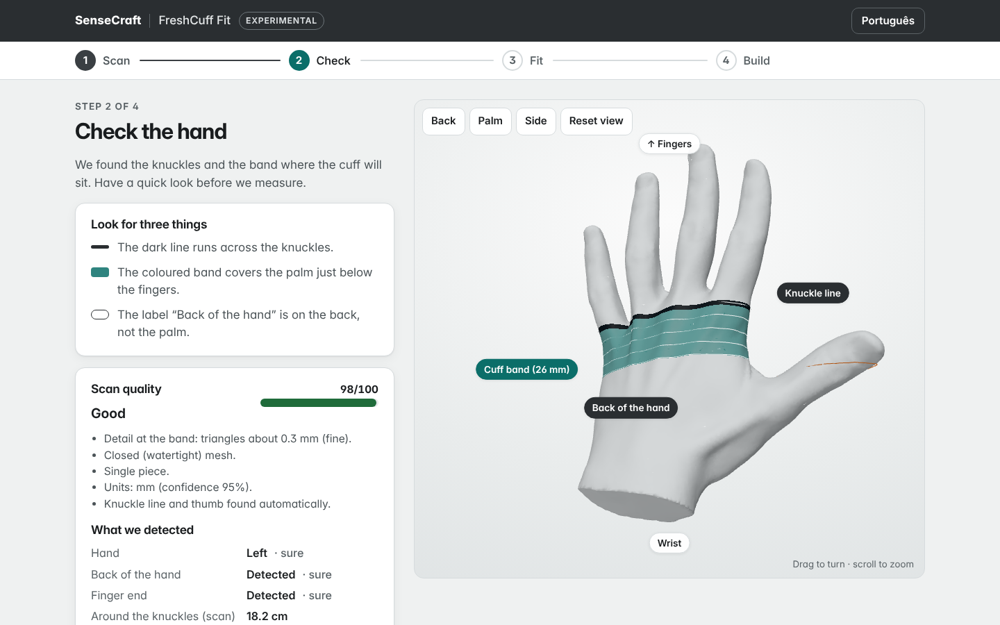
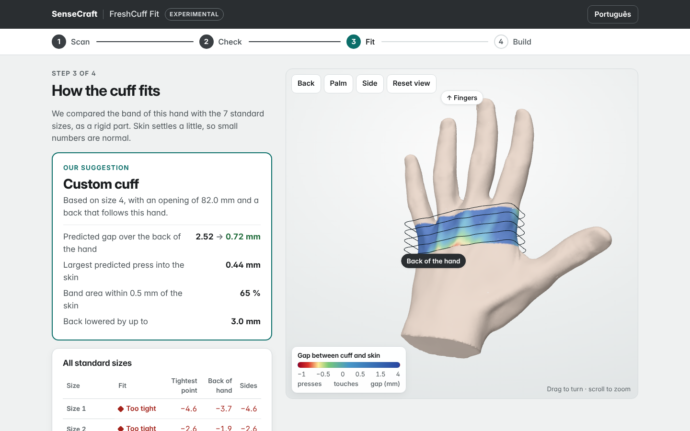
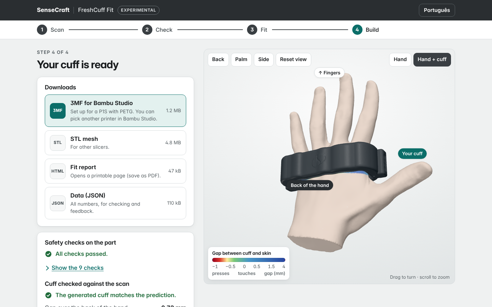

# FreshCuff Fit

**Turn a 3D scan of your hand into a custom, 3D-printable FreshCuff, right in your browser. Your scan never leaves your computer.**

**[Try it online](https://sensecraft3d-eng.github.io/freshcuff-fit/)** · [How to scan your hand](docs/SCANNING.md) · [How it works](docs/METHOD.md) · [What has been validated](docs/VALIDATION.md) · [Give feedback](https://github.com/sensecraft3d-eng/freshcuff-fit/issues/new?template=fit-feedback.yml)

<p align="center">
  
  
  
</p>

FreshCuff is a 3D-printed PETG cuff worn around the hand at the knuckles. It is for people with a weak grip who cannot hold a hair brush or a bath sponge. A palm support sits below, a flexible spring leaf rests on the back of the hand, and a latch plate holds interchangeable heads: a soft brush, a comb, a sponge basket or a universal head. FreshCuff comes in seven standard sizes, with printable sizing rings, on [MakerWorld](https://makerworld.com/en/models/3595433). It is SenseCraft's entry in MakerWorld's *Make for Good* accessibility contest.

FreshCuff Fit is the companion app. It reads a scan of your hand, checks it against all seven sizes and, if your hand is in the custom range, builds a cuff shaped to the back of your hand.

> [!WARNING]
> **Experimental. Not yet validated on a real wearer.**
> - So far the generated cuffs have been checked **in CAD only** (geometry against the scan). Nobody has worn a custom cuff from this app yet.
> - I (Pedro, SenseCraft) paid a professional scanning service (EinScan Rigil) to scan my own hand and I am waiting for the files. When they arrive I will run the generator on my hand, print and wear the cuff, and correct the generator if needed. Progress is tracked in [docs/VALIDATION.md](docs/VALIDATION.md).
> - **FreshCuff is not a medical device.** Always dry-fit first, stop if anything hurts or feels too tight, and check the skin after use. If you have fragile skin, poor sensation or circulation problems, ask a clinician (for example an occupational therapist) before using it.
> - If you have a hand scan and try the app, **your feedback is very welcome**. See [Feedback](#feedback).

## What it does

1. **Reads your scan.** STL, OBJ, PLY, GLB or USDZ, in any orientation. It works out the units (metres, centimetres or millimetres), whether it is a left or right hand, which side is the back of the hand, and where the knuckles and thumb are. You see the result in 3D and can correct it before going on.
2. **Finds the band.** This is the 26 mm strip just behind the knuckles where the cuff sits. The app samples it at five cross-sections.
3. **Compares all seven standard sizes.** Each size is seated rigidly on the band, and the app reports which ones fit and which one it recommends.
4. **Builds a custom cuff if your hand is in the custom range.** The range is an opening width of 80–84 mm, around size 4. The app picks the width in 0.5 mm steps and lowers the spring face by up to 3 mm to follow the back of your hand. Outside that range it recommends a standard size instead.
5. **Checks the cuff and hands you the files.** The finished solid must pass manufacturing checks, and it is checked again against your scan. Only then do you get a Bambu Studio project (`.3mf`, PETG, ready for the P1S and easy to switch to another printer), the `.stl` and a printable fit report. A custom cuff has an **R** or **L** and an arrow pointing to the fingers engraved on it.

## Why fit from a scan?

Two hands with the same knuckle width can have quite different backs: one flat, one strongly arched, one sloping toward the thumb. A tape measure cannot see that, so a standard size can sit well on one of those hands and leave a gap or a pressure point on the other. In an earlier one-hand study I did this by hand on a contest evaluator's scan. A cuff shaped to that hand kept the spring within 0.5 mm of the skin, or touching it, at 73% of the sampled positions. The standard sizes managed 0–8%. This app automates that method. Details are in [docs/METHOD.md](docs/METHOD.md).

## Privacy

- Everything runs **in your browser**: Python compiled to WebAssembly ([Pyodide](https://pyodide.org)), loaded from the same site.
- **There is no server, no upload, no account, no analytics and no cookies.** Your scan is read from your disk into the page's memory and is gone when you close the tab.
- The app loads all its code and data from its own site and contacts no other server. You can check this in your browser's developer tools (Network tab).
- The offline launcher and the command-line tool work the same way, entirely on your computer.

See [PRIVACY.md](PRIVACY.md).

## Quick start

### 1. Online (nothing to install)

Open **<https://sensecraft3d-eng.github.io/freshcuff-fit/>** in a recent Chrome, Edge or Firefox on a desktop or laptop computer. Then either:

- click **Try with a sample hand** to see the whole process on a public scan, or
- choose your own scan file, check the detected landmarks, and follow the steps.

The first visit downloads roughly 40–50 MB: the Python runtime and the cuff geometry. Your browser caches it for later visits. On the sample hand, a full run (read, check, fit and build) takes about one minute in Chrome on a modest two-core machine. Larger scans take longer.

### 2. Offline on your computer

Download the repository: **Code → Download ZIP** on GitHub, then unzip it. Double-click the launcher for your system:

| System | Launcher |
|---|---|
| Windows | `launchers/FreshCuff-Fit-Windows.bat` |
| macOS | `launchers/FreshCuff-Fit-macOS.command` (first time: right-click → Open) |
| Linux | `launchers/freshcuff-fit-linux.sh` |

The launcher starts a small web server on your own computer (`127.0.0.1`) and opens the app in your browser. It needs Python 3.8 or newer. If you do not have Python, use the online version. It is the same app. More in [launchers/README.md](launchers/README.md).

### 3. Command line (for makers and developers)

```bash
python -m pip install numpy scipy shapely trimesh matplotlib networkx
python fc_cli.py examples/Artec_Hand.ply --out out/artec --side auto --tape-cm 18.2 --build
```

The CLI uses the same Python code as the web app and writes the same files: report, `.3mf` and `.stl`. Run `python fc_cli.py --help` for all options.

## Scanning your hand

You can use a phone app (Polycam, Scaniverse, KIRI Engine, Heges, 3d Scanner App) or a handheld scanner (EinScan, Revopoint, Creality, Bambu Lab S1). The pose matters most:

- open, relaxed hand;
- fingers straight, with a small gap between them;
- thumb held away from the palm;
- straight wrist;
- about 5 cm of forearm in the scan.

The band behind the knuckles must be complete all the way round. Also measure around your knuckles with a soft tape in the same pose. The app uses it to double-check the scale.

Full guide: **[docs/SCANNING.md](docs/SCANNING.md)**.

## Documentation

| Document | For |
|---|---|
| [docs/USER_GUIDE.md](docs/USER_GUIDE.md) | People who will wear a cuff, and their helpers |
| [docs/MAKER_GUIDE.md](docs/MAKER_GUIDE.md) | Makers: printing, post-processing, assembly, checks before handing over |
| [docs/SCANNING.md](docs/SCANNING.md) | How to scan a hand for this app |
| [docs/METHOD.md](docs/METHOD.md) | How the analysis and the cuff generation work |
| [docs/VALIDATION.md](docs/VALIDATION.md) | What has been verified, what has not, and the validation plan |
| [cad/README.md](cad/README.md) | CAD sources and how to regenerate the solids |
| [CONTRIBUTING.md](CONTRIBUTING.md) | How to contribute code, data or feedback |

## Validation status

| Checked | Status |
|---|---|
| Generated solid passes the manufacturing checks (wall and spring thickness, slot, single watertight body, fasteners untouched) | Yes, automatically, on every cuff |
| Generated cuff re-checked against the scan | Yes, automatically, on every cuff |
| Browser gives the same result as desktop Python | Yes, on the sample scan |
| Browser solid vs full CAD rebuild | Yes. On the sample scan, 99% of the surface is within 0.019 mm |
| **Worn by a real person** | **Not yet.** See the [validation plan](docs/VALIDATION.md#validation-plan) |

## Licence

| Part | Licence | In short |
|---|---|---|
| Source code | [PolyForm Noncommercial 1.0.0](LICENSE) | Free to use, change and share for any non-commercial purpose |
| CAD, geometry and generated cuffs (`cad/`, `web/grade/`, `web/dados/`, your generated `.stl`/`.3mf`) | [CC BY-NC-SA 4.0](LICENSE-CAD.md) | Free to print, remix and share non-commercially, with credit, under the same licence |
| Sample scan, Python runtime, three.js, Inter font | Their own licences | See [NOTICE.md](NOTICE.md) |

Printing a cuff for yourself or for someone you help, without charging, is fine. **Selling prints** needs a commercial licence. SenseCraft offers one through its MakerWorld membership (see the [model page](https://makerworld.com/en/models/3595433)). For other commercial use, please ask in an issue.

## Credits

- **Design and app:** Pedro, [SenseCraft](https://makerworld.com/en/models/3595433).
- **Sample scan:** "Hand" by Artec 3D, <https://www.artec3d.com/3d-models/hand>, CC BY 3.0.
- **Anatomical data:** the CeTI-Age hand-scan dataset by Muschter et al., CC0 (<https://doi.org/10.6084/m9.figshare.23502060.v1>), used to shape the standard cuff's spring.
- **Software:** Pyodide, NumPy, SciPy, Shapely/GEOS, trimesh, Matplotlib, NetworkX, three.js, OpenCascade/OCP and the Inter typeface. See [NOTICE.md](NOTICE.md).
- **Contest:** MakerWorld *Make for Good*. Thanks to the evaluators whose scans and comments shaped this work.

To cite this project, use [CITATION.cff](CITATION.cff) (GitHub shows a "Cite this repository" button).

## Feedback

The most useful thing you can do is try it and tell me what happened.

- **Fit feedback:** [open a fit report](https://github.com/sensecraft3d-eng/freshcuff-fit/issues/new?template=fit-feedback.yml). It is a short form: scanner, size, what you saw on a dry fit. You can attach the app's report file (`.json`). **Do not attach your scan** unless you really want to share it publicly.
- **Bugs:** [open a bug report](https://github.com/sensecraft3d-eng/freshcuff-fit/issues/new?template=bug.yml).
- **Security problems:** see [SECURITY.md](SECURITY.md).
