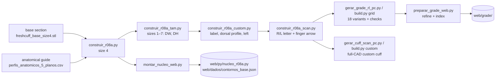

# FreshCuff CAD sources

This folder holds the CAD generator behind every FreshCuff solid: the seven standard sizes, the custom cuffs, and the width variants that the web app starts from. It uses OpenCascade through the `cadquery-ocp` Python bindings.

**Licence:** CC BY-NC-SA 4.0 (see [`../LICENSE-CAD.md`](../LICENSE-CAD.md)). This covers the scripts, the assets (including the base STL) and every solid you build with them. The SenseCraft "S" logo is not licensed as a trademark.

> **You do not need anything in this folder to use the app or to print a cuff.** The web app and the CLI use the pre-built variants in `web/grade/` and the section data in `web/dados/`. This folder is for transparency, review, and for makers who want to regenerate or modify the geometry.

## Setting up

Python 3.12 or newer, 64-bit.

```bash
python -m venv .venv
# Windows: .venv\Scripts\activate      macOS/Linux: source .venv/bin/activate
python -m pip install cadquery-ocp trimesh shapely scipy numpy matplotlib manifold3d
```

- `cadquery-ocp`, `trimesh`, `shapely`, `scipy`, `numpy`: needed for every build.
- `matplotlib`: draws the engraved size number and R/L letter (DejaVu Sans Bold, shipped with matplotlib).
- `manifold3d`: only for the manufacturing checks of the custom and grid builds. Without it the solids are still built and the checks are skipped.

No `PYTHONPATH` setup is needed. All scripts find their inputs relative to `cad/` (see `src/paths.py`), from any working directory.

## Building

All commands run from the repository root. The output folder must not exist yet: builds never overwrite.

```bash
# a standard size (1-7), or all seven into size1/ ... size7/
python cad/build.py size 4 --out cad/out/size4
python cad/build.py size all --out cad/out/sizes

# a custom cuff from a parameters file
python cad/build.py custom my_params.json --out cad/out/custom

# the 18 width variants used by the web app (W 80.0-84.0 mm, right and left)
python cad/build.py grid --out cad/out/grid
python cad/build.py grid --out cad/out/grid_one --only W82.0_R      # one variant
python cad/build.py grid --out cad/out/grid_web --web               # also the refined meshes + index, as in web/grade/
```

Each build writes a STEP and an STL (millimetres). `cad/out/` is ignored by git.

| Command | Output |
|---|---|
| `size N` | `FreshCuff_R08A_T<N>.step`, `.stl`, `build.log` (sizes other than 4 also write `contornos.npz`, the 2D section outlines) |
| `custom` | `<id>/cuff_<id>.step`, `.stl`, and `build.json` with the parameters, timing, STL hash and check results |
| `grid` | `<id>/cuff_<id>.step`, `.stl` for each variant, and `indice_grade_rl.json` (same format as `src/gerar_grade_rl_pc.py`). With `--web`: `web/<id>.stl` and `web/indice_grade_web.json` |

`<id>` is `W<width>_<R|L>`, for example `W82.5_L`.

### Standard sizes

The deformation of each size comes from `assets/verifica_tamanhos.json`, the table the published sizes were checked against:

| Size | Opening width W (mm) | DW | DH |
|---|---|---|---|
| 1 | 70 | −6.0 | −5.195 |
| 2 | 74 | −4.0 | −3.463 |
| 3 | 78 | −2.0 | −1.732 |
| 4 | 82 | 0 | 0 |
| 5 | 86 | 2.0 | 1.732 |
| 6 | 90 | 4.0 | 3.463 |
| 7 | 94 | 6.0 | 5.195 |

Size 4 is built by the base generator `src/construir_r08a.py`. The other sizes are built by `src/construir_r08a_tam.py`.

### Custom parameters

`custom` reads either of two JSON formats.

1. The `parametros.json` that the web app and `fc_cli.py` write next to the scan analysis (`W`, `dw`, `dh`, `esquerda`, `rotulo`, `dorso`). Example: `python fc_cli.py examples/Artec_Hand.ply --out out/artec --side left --tape-cm 18.2` writes `out/artec/analysis_01/parametros.json`.
2. A short file you write yourself:

   ```json
   {"W": 82.5, "side": "L", "dorsal_profile": "dorso.json"}
   ```

   `side` is `L`/`left` or `R`/`right`. `dorsal_profile` is optional. If you leave it out, you get the plain width variant. `dw` and `dh` are worked out from `W` (formula below) unless you give them.

The dorsal profile file (`dorso_*.json` from the scan analysis) needs two equal-length lists in the size-4 frame: `x_T4` (mm) and `raise` (mm, negative lowers the spring face). Relative paths are read from the folder of the parameters file. The web grid and its checks were validated for W 80–84 mm. Outside that range the build prints a warning, and the checks decide.

### Width parameters

A variant of opening width `W` (mm) is the size-4 geometry (W = 82 mm) with:

```
DW = (W − 82) / 2               # applied on each side
DH = 35.5 × (W / 82 − 1)        # height change on the flanks (rounded to 4 decimals for the grid)
```

For example, W = 82.5 gives DW = 0.25 and DH = 0.2165.

### Manufacturing checks

`custom` and `grid` measure each solid with the same functions that accepted the published grid (`src/gerar_grade.py`: `medir` and `trava`, with the section measurements of `src/medir.py`). The checks cover: one closed piece, band height 26 mm, spring leaf ≥ 0.85 mm, side gap ≥ 0.6 mm, slot 1.95–2.25 mm, shoulder wall ≥ 7.2 mm, longest side ≤ 160 mm, and the fastener region identical to size 4. That last check compares against a reference solid (W 82, label "C") that is built once into `cad/out/_cache/` the first time a check runs (about 25 s). A failed check gives a non-zero exit code and is listed in `build.json` / `indice_grade_rl.json` under `falhas` (G01–G13).

### Comparing meshes

```bash
python cad/compare.py cad/out/grid_one/W82.0_R/cuff_W82.0_R.stl web/grade/W82.0_R.stl
```

This prints the volumes, the bounding-box difference, and the two-sided surface deviation (closest-point distances from points sampled on both surfaces: maximum and 99th percentile). The files in `web/grade/` are refined (subdivided) copies of the CAD meshes, so their bytes never match a fresh build. Compare the geometry instead.

## Verification

These were run on Linux, Python 3.13, cadquery-ocp 7.9.3.1.1, from the repository root:

| Build | Result | Time |
|---|---|---|
| `size 4` | STL byte-identical to the published size 4 (SHA-256 `ad994669…`, as listed in `web/py/cuff_openings_R08A_v2.json`) | 22–30 s |
| `size 1`, `size 7` | STLs byte-identical to the published sizes 1 (`639a17e9…`) and 7 (`3793929c…`); size 7 built from a copy holding only the git-tracked files, run from another working directory | 22 s each |
| `grid --only W82.0_R` | vs `web/grade/W82.0_R.stl`: same volume (52 971.773 mm³, difference 0.0003 mm³), same bounding box, maximum surface deviation 0.000002 mm (20 000 samples per side); the same 86 220 faces after `--web` refinement; all checks equal to the published index | 24 s (+25 s once for the check reference) |
| `grid --jobs 2 --web` (all 18) | every variant vs its `web/grade/` file: volume difference ≤ 0.0004 mm³, identical bounding box, maximum surface deviation 0.000002 mm (float precision; 10 000 samples per side). The refined index matches `web/grade/indice_grade_web.json` field by field (faces, bytes, all check values) except the hashes and timings | 398 s in total (about 45 s per variant with 2 in parallel on a 2-core machine, so `--jobs 2` saved little there) |
| `custom` (Artec sample, left, W 82, dorsal profile) | all checks passed. `src/gerar_cuff_scan_pc.py` on the same folder gives the same STL hash, writes the 3MF and approves the verification against the scan. Compared with the browser build of the same case (`fc_cli.py --build`): volume difference 2.8 mm³ (0.005 %), mean deviation 0.0015 mm, 99th percentile 0.019 mm, max 0.24 mm. That is the expected gap between the browser's 2D displacement of a grid variant and the full CAD rebuild | 23 s |
| `src/montar_nucleo_web.py` | regenerates `web/py/nucleo_r08a.py` and `web/dados/contornos_base.json` byte for byte | 4 s |

The grid STLs differ from the files in `web/grade/` by a handful of re-triangulated facets (the tessellation is not bit-stable across OpenCascade builds and platforms), never in shape. The automated versions of these checks are in `tests/cad/` (`python -m pytest tests/cad -m slow`; the fast set runs without OCP).

## Files

| File | What it does |
|---|---|
| `build.py` | **One-command build** (sizes, custom, grid) described above. It runs the original scripts below, each in its own Python process. |
| `compare.py` | Geometry comparison of two meshes (volume, bounding box, sampled surface deviation) |
| `src/paths.py` | All input and output locations, relative to `cad/`. It also builds the check reference solid on first use. |
| `src/construir_r08a.py` | **Base generator: size 4.** Rebuilds the three section outlines (outer shell, skin-side opening, spring slot) from the base section and the anatomical guide. It lofts them over the 26 mm band and adds the fastener block, thumb tabs, the "S" logo and the size number. Writes STEP + STL. |
| `src/construir_r08a_tam.py` | **Seven standard sizes.** Same generator with a smooth 2D stretch of the outlines before the solid is made: width change `DW` where the walls are horizontal, height change `DH` on the flanks. Fastener block, thicknesses and radii are unchanged. |
| `src/construir_r08a_custom.py` | Custom variant of the above. It replaces the size number with a label (`--rotulo`), adds a personal dorsal profile (`--dorso file.json`) on top of the anatomical guide, and mirrors the outlines for a left hand (`--esquerda`). |
| `src/construir_r08a_scan.py` | Version used by the scan generator and the web grid. For labels `R`/`L` it engraves the side letter and an arrow pointing to the fingers on the plate face, under the latch plate. |
| `src/varredura.py` | Runs one builder case in a separate process with a time limit (`rodar`). It is used by `build.py`, the grid and the scan scripts. |
| `src/medir.py` | Section measurements of a built cuff (spring leaf, side gap, shoulder wall, slot, opening, fastener-region difference). Run on its own, it measures a sweep folder. |
| `src/gerar_grade.py` | The measurement wrapper (`medir`) and the pass/fail rules (`trava`, G01–G13) of the grid. Its `__main__` is the earlier phase-1 grid, kept for the record. |
| `src/gerar_grade_rl_pc.py` | Builds the **18 width variants** for the browser (W 80.0–84.0 mm in 0.5 mm steps, right and left, no dorsal profile) with the checks and an index: `python cad/src/gerar_grade_rl_pc.py OUT_DIR`. `build.py grid` does the same, with `--jobs`. |
| `src/preparar_grade_web.py` | Refines each variant mesh in the section plane (edges ≤ 1 mm in the dorsal region, conforming subdivision, so the mesh stays closed with the same volume). Writes the web STLs and `indice_grade_web.json` with SHA-256 hashes: `python cad/src/preparar_grade_web.py GRID_DIR OUT_DIR`. |
| `src/subdiv.py` | The conforming edge subdivision used above |
| `src/gerar_cuff_scan_pc.py` | Desktop path for a scan case: `python cad/src/gerar_cuff_scan_pc.py ANALYSIS_DIR` (the folder with `parametros.json`). It checks the parameter manifest against the current `web/py` files, builds the custom solid with full OpenCascade, runs the checks, writes the 3MF (with `web/py/trocar_malha_3mf_v4b_custom.py` and `web/dados/FreshCuff_R08A_T4_LISA_P1S_R05b.3mf`), and verifies the solid against the scan (`web/py/conferir_cuff_gerado.py`). Output goes to `ANALYSIS_DIR/cad/`. |
| `src/montar_nucleo_web.py` | Extracts, by script and without hand edits, the 2D part of the generator (everything up to the section outlines, no OpenCascade) and the base section data: `python cad/src/montar_nucleo_web.py OUT_DIR` writes `OUT_DIR/py/nucleo_r08a.py` and `OUT_DIR/dados/contornos_base.json`, to compare with `web/` (it never writes into `web/`). |
| `src/marca_num.py` | Digit or letter outline for engraving (DejaVu Sans Bold) |
| `src/servir_com_csp.py` | Small local test server that applies the headers from `web/_headers`. It was used for the first browser tests. `tools/serve.py` replaces it. |
| `src/original/` | Byte-exact copies of the scripts as they ran on the original workstation, before their paths were made relative (SHA-256 below). `montar_nucleo_web.py` reads `original/construir_r08a.py`, the file whose hash is recorded in `web/dados/contornos_base.json`. |
| `assets/freshcuff_base_size4.stl` | The previous cuff revision (R07i, size 4; 27 MB). The generator uses only its cross-section at z = 3.173 mm. SHA-256 `d819b2f9…`, as recorded in `web/dados/contornos_base.json`. |
| `assets/perfis_anatomicos_5_planos.csv` | Anatomical dorsal guide at five planes, derived from the CeTI-Age dataset (Muschter et al., CC0, <https://doi.org/10.6084/m9.figshare.23502060.v1>). The standard spring follows this shape. |
| `assets/SenseCraft_Icone_S_CAD_H7p00_v1_1.dxf` | The "S" logo outline, 7 mm high (trademark of SenseCraft, see the licence notes) |
| `assets/verifica_tamanhos.json` | Size table: W, DW, DH and the section measurements of the seven published sizes |
| `assets/equivalencia_tamanhos.json` | Record that the sweep generator reproduced the seven published sizes (deviation 0.0 mm) |

### What changed in the original scripts

Only the lines that located files changed. The geometry code and the Portuguese comments are as they were.

| Script | Change |
|---|---|
| `construir_r08a.py` | `PROJECT = parents[3]` and the work-folder paths → `paths.py` (base STL, guide, logo, `marca_num.py` folder) |
| `varredura.py` | Windows path of the generator folder → `cad/src` |
| `gerar_grade.py` | `../faixa` → `cad/src`. The 3MF base and the mesh-swap script → `web/dados`, `web/py`. The W82 reference → `paths.reference_stl()` |
| `gerar_grade_rl_pc.py` | Windows paths → `cad/src`. Optional output folder argument. W82 reference → `paths.reference_stl()` |
| `gerar_cuff_scan_pc.py` | Windows paths → `cad/src`. Manifest files and the scan verification → `web/py`, `web/dados`. W82 reference → `paths.reference_stl()` |
| `montar_nucleo_web.py` | Absolute paths → `paths.py` and `original/construir_r08a.py`. Output folder argument instead of the current directory. The OCP stub is optional. |

| Original file | SHA-256 |
|---|---|
| `original/construir_r08a.py` | `035d95f8ac2f0ce2ff23a5da1a0060b661f82c33a9485ab5f989e75b453bee25` |
| `original/gerar_cuff_scan_pc.py` | `b7fe88747a769b7f538d2d8f7eef93c1dafc05d1ced0c0ed9566f0a4e9e91961` |
| `original/gerar_grade.py` | `92bf7c7ba3b244c1c4c2e5e8ea7346de1d801ab80a04763884521b61a494a36f` |
| `original/gerar_grade_rl_pc.py` | `918bb09b88aaac52c59b06cf8bbb0c0e70cd8ff40ea0f9d81aebab863336283b` |
| `original/montar_nucleo_web.py` | `49dc3fdb6c8367c277efbf792989699912c429c9fbe611ed56721b16dd3cfdd1` |
| `original/varredura.py` | `0cc88a2254bb701c73dff3657df234c54234cb930c6a9a35d0c12a52ae00fc4c` |

The builders `construir_r08a_tam.py` (`bb015fd8…`), `construir_r08a_custom.py` (`edc9c282…`) and `construir_r08a_scan.py` (`9cbc3236…`) are unchanged.

## Pipeline



### Running a builder directly

`build.py` calls these. You can also run them yourself (the output folder must not exist yet):

```bash
python cad/src/construir_r08a.py cad/out/T4
python cad/src/construir_r08a_tam.py cad/out/T5 --tam 5 --dw 2 --dh 1.732
python cad/src/construir_r08a_scan.py cad/out/W82.5_L --rotulo L --dw 0.25 --dh 0.2165 --esquerda
python cad/src/construir_r08a_scan.py cad/out/custom_L --rotulo L --dw 0.25 --dh 0.2165 --esquerda --dorso dorso.json
```

A build takes about 20–30 s per solid on one CPU core and about 1 GB of RAM.

## Conventions

- Units: millimetres.
- CAD frame: the band runs along z from 0 to 26 mm, with the finger-side end at small z (the five reference sections are at z = 0.2, 6.5, 13.0, 19.5 and 25.8). For a right hand the thumb is on −x. y points from the palm toward the back of the hand. Left-hand cuffs are mirrored in x after the outlines are built, so the engraved text is not mirrored.
- The web app displays everything in its own canonical frame (see [`docs/METHOD.md`](../docs/METHOD.md#2-hand-frame-and-landmarks)).

## Glossary of Portuguese terms in the code

| Portuguese | English |
|---|---|
| faixa | band (the 26 mm strip behind the knuckles) |
| corte | cross-section |
| nós (dos dedos) | knuckles |
| polegar / dedo mínimo | thumb / little finger |
| dorso / palma | back of the hand / palm |
| lâmina (da mola) | spring leaf |
| fenda | spring slot (the gap behind the leaf) |
| vão lateral | side gap of the slot |
| aro / ombro | shoulder wall |
| fixadores | fasteners (latch plate attachment) |
| folga | gap, clearance |
| sobreposição | overlap |
| trava | manufacturing check |
| grade | grid of width variants |
| rótulo | engraved label |
| direita / esquerda | right / left |
| largura / altura | width / height |
| tamanho | size |
| varredura | sweep (batch of builder runs) |
| conferência | verification (generated cuff vs scan) |
| aprovado / reprovado | accepted / rejected |
