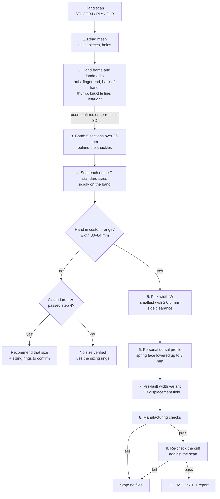

# How FreshCuff ScanMade works

This document explains, step by step, what the app does with a hand scan and how it turns the result into a printable cuff. It is technical but meant to be readable. Every number below is a parameter in the code (`web/py/`), and the generated report records the values used in each run.

> **What this method is:** a rigid, geometric comparison between cross-sections of a scanned hand and the cross-sections of the cuff.
> **What it is not:** a model of skin pressure, comfort, grip or how the spring bends. See [What the method does not model](#what-the-method-does-not-model).

- [Overview](#overview)
- [1. Reading the scan](#1-reading-the-scan)
- [2. Hand frame and landmarks](#2-hand-frame-and-landmarks)
- [3. The band](#3-the-band)
- [4. Comparing the seven standard sizes](#4-comparing-the-seven-standard-sizes)
- [5. Choosing the custom width](#5-choosing-the-custom-width)
- [6. Personal dorsal profile](#6-personal-dorsal-profile)
- [7. Building the solid in the browser](#7-building-the-solid-in-the-browser)
- [8. Manufacturing checks](#8-manufacturing-checks)
- [9. Checking the generated cuff against the scan](#9-checking-the-generated-cuff-against-the-scan)
- [10. Side letter and finger arrow](#10-side-letter-and-finger-arrow)
- [11. Output files](#11-output-files)
- [When the app refuses](#when-the-app-refuses)
- [What the method does not model](#what-the-method-does-not-model)
- [Where the method comes from](#where-the-method-comes-from)

## Overview



The same Python code runs in the browser (Pyodide) and on the desktop (`fc_cli.py`, the tests). The browser only adds the 3D viewer and the user's corrections.

## 1. Reading the scan

- **Formats.** STL, OBJ, PLY and GLB are read by `trimesh`. A USDZ file is first converted to a mesh in the page by the three.js USDZ loader. Multi-part files are merged into one mesh.
- **Loose pieces.** The mesh is split into connected pieces. Pieces with fewer than 2% of the faces of the largest piece are dropped. These are typically bits of the table or floating noise. Larger extra pieces are kept and reported.
- **Units.** Scans arrive in metres, centimetres or millimetres, and most files do not say which. The app looks at the largest dimension of the mesh:

  | Largest dimension of the file (in its own units) | Interpreted as | Scale to mm |
  |---|---|---|
  | below 2 | metres | × 1000 |
  | 2 to 40 | centimetres | × 10 |
  | 40 or more | millimetres | × 1 |

  A hand with a bit of forearm is 150–250 mm long, so the three ranges do not overlap. You can always override the guess with an explicit scale (mm per file unit).
- **Holes.** The app tracks open edges (borders of holes). A hand scan is normally open where the forearm was cut, and that is fine. Holes **inside or near the band** are not: see [When the app refuses](#when-the-app-refuses).
- **Size limit.** Scans up to about 150 MB (roughly 3 million triangles in binary STL) are accepted.
- **Scan quality.** The app summarises the checks above (scale guess, pieces, holes near the band, how cleanly the landmarks were found) as a score with plain-language notes. The score is a guide for re-scanning, not a pass/fail on its own.

## 2. Hand frame and landmarks

**Axis.** Principal component analysis (PCA) of the mesh vertices gives three axes. The longest is the hand axis (fingers ↔ wrist), the middle one is the width (thumb ↔ little finger) and the shortest is the thickness (palm ↔ back of the hand).

**Which end has the fingers.** The app cuts the mesh across the axis near each end. Near the fingertips a cut usually gives several separate pieces (one per finger). Near the forearm it gives one. If the two ends look the same, the app asks you.

**Profile along the hand.** The mesh is cut every 1.5 mm along the axis. For each cut the app records the width of the main piece and how many pieces there are.

```
 width of the main piece
   ^
   |            ┌──────────────┐
   |            │              │ ← palm + thumb
   |  forearm   │              └──┐      ← 1st sudden drop: thumb separates
   | ───────────┘                 └────┐
   |                                   └───┐  ← 2nd drop: fingers separate
   |                                       └─ ─ ─ fingers
   +-------------------------------------------------> along the hand (toward fingers)
                                 knuckle line = 2nd drop − 6 mm
```

A **sudden drop** is a step where the width of the main piece falls by more than 15% and the cut splits into two or more pieces. The first drop is where the thumb separates and the second is where the fingers separate. The **knuckle line** is placed 6 mm behind the finger separation, toward the wrist. In the browser you can correct the knuckle line and the thumb position if they are wrong.

**Back of the hand vs palm.** Two independent cues:

1. At the knuckles the back of the hand is arched, while the palm is flatter or slightly hollow. The app compares the arch height (sagitta) of the top and bottom outlines.
2. The thumb sits on the palm side of the hand.

If the two cues disagree, the app does not guess. It shows you the scan and asks which side is the back. That typically happens with curled fingers. If they agree but the arch difference is small (under 1 mm), you get a warning to check.

**Left or right.** Once the back of the hand is known, the side of the thumb tells left from right. A left hand is mirrored into the right-hand frame for the whole analysis. The cuff is mirrored back at the end. If you declare a side and it disagrees with the scan, the app stops and asks you to check. A mirrored scan, or a back/palm swap, would otherwise give the wrong cuff.

**Tape check.** The convex outline of the cut at the knuckle line is what a tape measure would read around the knuckles. If you enter your own tape measurement, the app compares the two. A difference of more than **0.6 cm** suspends the automatic recommendation, because it usually means a wrong scale, a different pose, or the tape in a different place.

The standard size chart by knuckle circumference, which the app also uses, is:

| Size | 1 | 2 | 3 | 4 | 5 | 6 | 7 |
|---|---|---|---|---|---|---|---|
| Tape around the knuckles (cm) | < 18.2 | 18.2–19.3 | 19.3–20.4 | 20.4–21.6 | 21.6–22.7 | 22.7–23.8 | ≥ 23.8 |

Within 0.3 cm of a boundary, the report suggests trying the neighbouring size as well. The printed **sizing rings** on MakerWorld decide; the scan does not decide alone.

**Canonical frame.** After this step everything (and every 3D view in the app) uses one frame, in millimetres:

```
            +y  back of the hand (up)
             ^
             |
             |
  thumb  <---o--->  +x  little finger (of a RIGHT hand; left hands are mirrored for display only if needed)
            /
           v
         +z  toward the wrist          origin = centre of the band
```

The CAD of the cuff uses the same idea with the thumb on −x. The conversion between the two is a mirror in x, and the code keeps track of it.

## 3. The band

The cuff is 26 mm long along the hand. Its finger-side edge sits on the knuckle line. The app takes **five cross-sections** of the hand at the positions of the five reference sections of the cuff:

```
  fingers                                                    wrist
     |<------------------------ 26 mm ------------------------>|
     |  0.2           6.5          13.0         19.5        25.8|   cuff section positions (mm)
     |   ┊             ┊             ┊             ┊           ┊ |
  knuckle line                                                     (band = hand between these planes)
```

For each section the app checks that:

- the cut is a **closed** outline (no open hole edges longer than 5 mm), and there are no gaps when the band is re-sampled every 0.5 mm;
- the section does not reach the **base of the thumb**. If it does, the result is labelled "exploratory": the app shows a comparison with the thumb base cropped off, but does not build a custom cuff;
- the section centres stay in line. If they drift sideways by more than 8 mm over the 26 mm, the band is probably at an angle to the hand (bent wrist), and you get a warning.

## 4. Comparing the seven standard sizes

For each size the app has the **inner opening** of the cuff at the same five positions, taken from the CAD. The comparison asks: *can this rigid cuff sit on this rigid band?*

**One rigid placement for all five sections.** The hand sections move together, as one body:

| Search variable | Range | Coarse step | Fine step |
|---|---|---|---|
| Roll about the band centre | ±8° | 2° | 0.5° |
| Sideways shift | ±5 mm | 1 mm | 0.25 mm |
| Height | −1 to +10 mm | 0.5 mm | 0.1 mm |

For each roll and shift, the hand is **lowered onto the palm support** to the lowest height that is acceptable, because the spring presses the hand down onto it. Among the acceptable placements the one with the largest margin wins. Margins within 0.1 mm of each other count as a tie, and then the smaller roll and the smaller shift win.

**What "acceptable" means.** There are two stated assumptions:

1. **Skin tolerance, 0.5 mm.** The rigid parts of the cuff (palm support, side walls) may overlap the scanned surface by up to 0.5 mm, as skin and soft tissue give a little. This value is an assumption to be calibrated on a real wearer, not a measurement.
2. **Spring envelope, 2.1 mm.** In the central zone of the back of the hand (±26 mm from the centre), the hand may push the spring face up by as much as the spring's nominal travel to its stop, 2.1 mm. This is a geometric envelope. It is not an elastic simulation of the spring.

```
   cross-section, looking along the hand (schematic, not to scale)

         ┌──────────────── outer shell ────────────────┐
         │   ═══════════ slot (≈ 2.1 mm travel) ══════ │
         │  ~~~~~~~~~~~~~~ spring leaf ~~~~~~~~~~~~~~~ │  ← spring face, touches the back of the hand
         │                                             │
  side   │               BACK OF THE HAND              │   side
  wall   │                                             │   wall
         │                    PALM                     │
         └────────────── palm support ─────────────────┘
                  [ fastener block · latch plate ]
```

For each size the report gives three numbers, all as the worst case across the five sections:

- `rigid_min`: the smallest distance between the hand and the rigid parts. Negative means overlap, accepted down to −0.5 mm.
- `dorsal_min`: the smallest gap between the back of the hand and the spring face. Negative means the hand lifts the spring, accepted down to −2.1 mm.
- `lateral_min`: the smallest side clearance.

**Recommendation.** The app reports the size given by the tape, and the smallest size whose shape fits the band under the two assumptions. When they differ, the report says so. The final choice is made with the sizing rings and a dry fit.

## 5. Choosing the custom width

A custom cuff is offered when the hand fits the **custom range**: cuff opening widths **W = 80 to 84 mm**, around size 4 (W = 82 mm). This range is deliberately narrow while the custom geometry is unvalidated.

The width variants step by **0.5 mm** (80.0, 80.5, … 84.0: nine widths). Each width is a smooth stretch of the size-4 geometry. The cuff is widened where its walls are horizontal (top and bottom), and the flanks translate outward. The height grows with the width, by 35.5 mm × (W / 82 − 1). The total height stays within +1.5 mm of size 4. The fastener block, wall thicknesses and radii are unchanged.

For each width the hand is seated as in step 4. The app keeps the **smallest width that seats and leaves at least 0.5 mm of clearance on both sides**. The seating keeps a further 0.05 mm inside the skin assumption, as margin for the mesh. If no width seats, or if even 80 mm leaves more than 6 mm of side clearance (the hand is too narrow for the custom range), no custom cuff is made. The app then recommends a standard size only if one passed the check in step 4; otherwise it says that no size was verified and suggests the printed sizing rings.

If the chosen placement uses more than 0.4 mm of the 0.5 mm skin allowance under the palm, the report adds a warning. This is a geometric assumption, not a pressure measurement.

## 6. Personal dorsal profile

The standard spring face follows an average back of the hand. That shape came from 63 public hand scans in the CeTI-Age dataset. A custom cuff lowers the spring face to follow **your** back of the hand:

1. In the chosen placement, the app measures the vertical **gap between the back of the hand and the spring face**. It does this every 0.5 mm across the central ±26 mm and keeps, at each point, the **smallest gap over the five sections** (the closest section).
2. The face is lowered by that gap **plus a 0.2 mm preload** (target: light contact), clipped to **0–3.0 mm**. The face is only ever lowered, never raised.
3. **Taper.** The lowering fades to zero between 12 and 24 mm from the centre on the thumb side, and between 20 and 26 mm on the little-finger side. The edges of the spring and everything outside the central zone keep the standard geometry.
4. **Smoothing.** A Gaussian filter with σ = 1.5 mm, then the taper is applied again, and the lowering is set to zero where the scan has no hand.
5. The profile is moved from the width-W frame back into the size-4 frame of the CAD generator, where it is added to the standard anatomical guide.
6. **Outside unchanged.** The profile moves the spring face and the slot behind it together, so the spring keeps its thickness and its 2.1 mm travel. The outer shell, with the logo, is not moved: it stays exactly as in the standard cuff of the same width. The wall above the slot gets thicker by the same amount, up to 3 mm (about 2.5 cm³ more material on the sample hand).

```
   gap before (closest section)              lowering applied (mm)
   ───────────────────────────               ─────────────────────
   spring face ─────────────────             0 ┤▁▁▂▃▅▆▇██▇▇▆▅▄▃▂▁▁▁▁ (≤ 3.0)
               ╲     hand     ╱                │ thumb side    little-finger side
                ╲___________╱                  └──────────────────────────
                                               −26        0         +26 mm
```

The profile is **one curve applied along all 26 mm**. The hand tapers toward the wrist, so the closest section ends up near contact while the other sections keep some gap. This is intentional: the profile should never press harder than the closest section allows.

**Prediction.** The five sections are re-evaluated with the lowered face in the same placement. This gives the predicted gap at the closest section, the share of the width within 0.5 mm, and the largest overlap, which must stay below the 2.1 mm spring travel.

## 7. Building the solid in the browser

The full CAD generator uses OpenCascade, which does not run in a browser. The app gets the same solid another way:

1. **Pre-built width variants.** All 18 variants (9 widths × right/left, each with its side letter and arrow) were generated beforehand by the CAD generator in `cad/src/`. Each passed the manufacturing checks of step 8. They are stored in `web/grade/` and the browser downloads only the variant it needs, about 4–5 MB. `python cad/build.py grid` rebuilds them from the repository.
2. **2D displacement field.** The cuff's cross-section is defined by three outlines: the outer shell, the skin-side opening and the spring slot. In the browser, the CAD's own 2D routine (`nucleo_r08a.py`, extracted from the CAD generator by a script, not rewritten) computes these outlines twice: without and with your dorsal profile. The difference between the two is a displacement field in the section plane. The outer shell is the same in both, so its displacement is zero.
3. **Applying it.** Every vertex of the variant mesh is moved by the displacement of the nearest outline point. The field depends only on the position in the section (x, y), so it is the same along the band. The variant meshes were refined beforehand so that no edge in the dorsal region is longer than 1 mm. That lets the surface follow the new curve, and the refined mesh is still closed and has the same volume.
4. **What does not move.** Vertices in the fastener region must have zero displacement, and this is checked. So the fastener geometry stays exactly as in the pre-checked variant.

**Validation against the full CAD.** On the sample scan, the browser-built solid was compared with a full OpenCascade rebuild using the same parameters. 99% of the surface lies within **0.014 mm** of the CAD, and the largest deviation is 0.04 mm. Since the outside is no longer moved, the "S" logo is identical in both. All manufacturing checks gave the same results within a few thousandths of a millimetre. Numbers for the current version are in [VALIDATION.md](VALIDATION.md).

## 8. Manufacturing checks

Every generated solid is measured, and any failed check stops the build. No files are offered. All values are compared unrounded, and any non-finite value (NaN or infinity) counts as a failure.

| Check | Requirement | Why |
|---|---|---|
| Single watertight body | 1 closed body | Slicers and printers need a clean solid |
| Band length | 26 mm ± 0.05 | Same length as the standard cuff |
| Spring leaf thickness | ≥ 0.85 mm everywhere | Thinner leaves become fragile in PETG |
| Side gap of the spring slot | ≥ 0.6 mm | The leaf must stay free of the frame at its sides |
| Shoulder wall (outer wall over the slot, toward the sides) | ≥ 7.2 mm | Keeps the frame strong around the spring slot |
| Spring slot height | 1.95–2.25 mm | Sets the spring travel (nominal 2.1 mm) |
| Fastener region | Untouched (zero displacement; variant check ≤ 0.1 mm³ difference from size 4) | The latch plate and accessories must fit exactly as on standard cuffs |
| Overall size | Largest dimension ≤ 160 mm | Sanity limit: catches a runaway deformation |

## 9. Checking the generated cuff against the scan

After the build, the app re-slices **the generated mesh itself** at the five band positions and repeats the comparison with your hand sections:

1. **Same placement as predicted.** It measures the gap to the back of the hand, the rigid overlap and the side clearance using the new solid's openings.
2. **Fresh placement search.** It checks whether the hand still seats when the search of step 4 is run again on the new solid.

The cuff is **accepted** only if all of the following hold:

- the gap at the closest section matches the prediction within 0.15 mm;
- the largest dorsal overlap is below the spring travel (2.1 mm);
- the rigid overlap is no worse than −0.5 mm;
- the side clearance is at least the target minus 0.1 mm;
- the hand seats in the fresh search.

Otherwise the build stops and no files are offered.

## 10. Side letter and finger arrow

A custom cuff is not symmetric, because the profile follows your hand. Each custom cuff therefore has an **R** or **L** and an **arrow pointing to the fingers**, engraved 0.4 mm deep on the plate face, between the fastener holes. They sit under the latch plate, where standard cuffs carry their size number. When you assemble, the triangle on the latch plate goes on the arrow side. When you wear the cuff, with your fingers up, the arrow points up and the letter reads upright.

## 11. Output files

| File | Content |
|---|---|
| `.3mf` | Bambu Studio project: the custom cuff in the print orientation, PETG profile for the Bambu Lab P1S (0.4 mm nozzle), seam painting, local reinforcement around the fastener housings. Switch the printer in Bambu Studio if needed. See [MAKER_GUIDE.md](MAKER_GUIDE.md). |
| `.stl` | The cuff mesh alone, for other slicers |
| report (`.json`, `.html`) | Every input, landmark, placement, check and measurement, with SHA-256 hashes of the output files. The HTML version can be printed to PDF. |

## When the app refuses

The app prefers to stop with a clear reason over building a cuff from doubtful data. In the browser, most of the orientation questions are resolved by asking you to confirm or flip in 3D.

| Situation | What happens |
|---|---|
| Most cuts are open (the mesh is mostly holes) | Stops: re-scan or close the mesh |
| An open edge within 10 mm of the band | Stops before building: close the holes in the scanner software or re-scan |
| Finger end, or back vs palm, ambiguous | Asks you to choose (CLI: stops with instructions) |
| Fewer than two sudden drops found (fingers stuck together, thumb against the hand) | Asks you to place the knuckle line and the thumb by hand |
| Band reaches the thumb base | Exploratory size comparison only, no custom cuff |
| Scan tape and measured tape differ by more than 0.6 cm | Automatic recommendation suspended, no custom cuff |
| Declared side differs from the scan | Stops: check the side, or the back/palm reading |
| No width 80–84 mm seats, or clearance too small or too large | No custom cuff. Recommends a standard size only if one passed the check; otherwise says no size was verified and suggests the sizing rings |
| A manufacturing check or the final scan check fails | Stops, no files |

## What the method does not model

- **Skin pressure and comfort.** The 0.5 mm skin tolerance and the 0.2 mm preload are geometric assumptions, not pressures. Soft tissue, swelling during the day and sensitivity all vary from person to person.
- **Elastic behaviour of the spring.** The 2.1 mm travel is the free gap to the stop. The app does not compute how much force the leaf exerts or how it deflects under load.
- **Wet use and grip.** Retention on wet or soapy skin, and the forces of brushing, are not modelled.
- **Hand movement.** The scan is one static pose. Knuckles change shape when the hand closes.
- **Scan error.** The result can only be as good as the scan. Phone scans in particular can smooth or inflate the surface by a millimetre or more. The tape check catches gross scale errors, not small shape errors.
- **Print variation.** Shrinkage, elephant's foot and seams are not modelled.

Only a physical dry fit can answer these questions. See [VALIDATION.md](VALIDATION.md) and the [User guide](USER_GUIDE.md).

## Where the method comes from

The app automates a custom-fit study I did earlier by hand on one hand. That study is published on MakerWorld as *FreshCuff_Custom_Fit_Example.pdf*. It used a left-hand scan shared by a contest evaluator (PaddleUp):

- the scan was mirrored into the right-hand frame;
- the hand axis was found by PCA of section centroids;
- the band origin was placed on the dorsal midline, about 30 mm behind the knuckle crest;
- the band was sampled with 25 sections over 24 mm;
- the cuff was seated rigidly on the palm support, with a roll search and a sideways shift, and with no penetration of the rigid walls;
- the fit was measured as the gap between the back of the hand and the spring face.

The cuff shaped to that hand kept the gap at **0.5 mm or less (or in contact)** at **73%** of the sampled positions. The standard sizes managed **0–8%**.

The app differs from that study in a few ways. It finds the landmarks automatically. It uses the five reference sections of the cuff over the full 26 mm. It allows the stated 0.5 mm skin tolerance on the rigid parts. It also adds the manufacturing checks and the re-check of the generated solid. On the sample scan, the current version's predicted and verified numbers are listed in [VALIDATION.md](VALIDATION.md).
