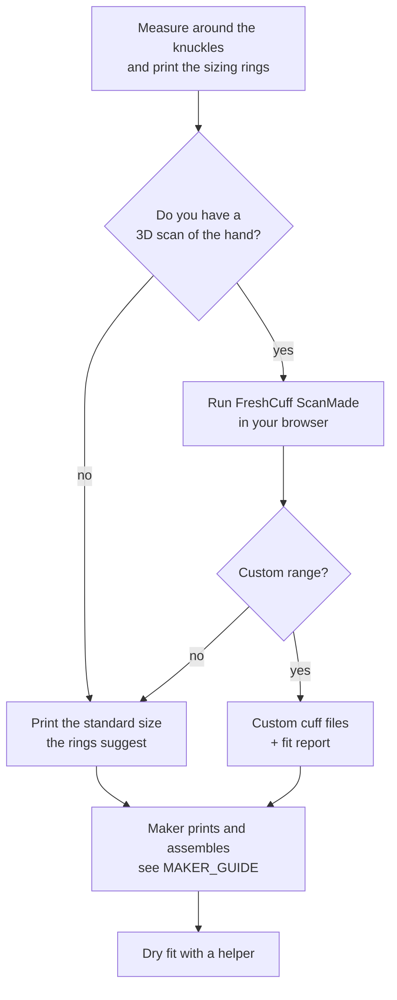

# FreshCuff user guide

*For the person who will wear a FreshCuff, and for family members, carers and therapists who help them.*

> **Experimental custom cuffs.** A custom cuff made with FreshCuff ScanMade has been checked in CAD only and has **not yet been tested on a real wearer**. So far, only the standard size-4 cuff has been worn: by me, during development. Please read [Safety](#safety) before the first fitting.

## What FreshCuff is

FreshCuff is a 3D-printed cuff worn around the hand, just behind the knuckles. It holds a grooming tool so you do not have to grip it.

- A **palm support** sits under the palm.
- A flexible **spring leaf** rests on the back of the hand and holds the cuff in place.
- A **latch plate** holds an interchangeable head: soft brush, comb, sponge basket or universal head.

It comes in **seven standard sizes**, with printable **sizing rings** to find yours: <https://makerworld.com/en/models/3595433>.

**FreshCuff ScanMade** (this project) is an app that reads a 3D scan of your hand. It recommends a standard size and, if your hand is in the custom range (around size 4), makes a cuff shaped to the back of your hand.

## Who it is for

- People with a **weak or painful grip** who find it hard to hold a hair brush, comb or bath sponge. Causes include arthritis, reduced hand strength after an injury or stroke, and neuromuscular conditions.
- People who can **open the hand enough** to slide it through a ring at knuckle level, either alone or with a helper.

## Who it is not for (or only with professional advice)

- People with **fragile skin, open wounds, swelling that changes a lot during the day, poor sensation or poor circulation** in the hand. You might not feel a pressure point developing. Ask a clinician, for example an occupational therapist, first.
- People who **cannot take the cuff off by themselves** and have no helper nearby while wearing it.
- Children, unless an adult supervises every use.
- Anyone looking for a medical splint or orthosis. **FreshCuff is not a medical device** and does not treat any condition.

## Safety

- **Always dry-fit first.** Try it on, without water or soap, for a few minutes, with someone nearby.
- **Stop at once** if anything hurts, pinches, tingles, goes numb or feels too tight, or if the fingers change colour.
- **Check the skin after every use**, especially at first. Light marks are normal. As a common rule of thumb for hand splints, **redness that has not faded about 20 minutes after removal** means too much pressure. Stop using the cuff and tell whoever made it.
- **Be able to take it off.** Practise removing it during the dry fit. If it is hard to remove, do not use it.
- **Do not sleep in it**, and do not wear it for long periods without breaks.
- **Wet use:** test first with water only. Soapy skin is slippery, so check that the cuff still stays in place.
- **Heat:** PETG softens with heat. Keep the cuff away from very hot water, dishwashers, radiators and hair-dryer heat.
- **Damage:** if the spring leaf cracks or the cuff develops sharp edges, stop using it and print a new one.
- **Custom cuffs** are shaped to one hand and are marked **R** or **L**. Do not swap them between hands or people.

## Getting a cuff

### Using the app (if you have a scan)

1. Open <https://sensecraft3d-eng.github.io/freshcuff-scanmade/> on a computer, or the offline launcher. Your scan **stays on your computer**.
2. Choose your scan file and enter:
   - which hand it is;
   - your tape measurement around the knuckles. See [SCANNING.md](SCANNING.md#tape-measure-check) for how to measure.
3. **Check the 3D view.** The app shows where it found the knuckle line, the thumb and the band. If something is wrong, correct it as the page explains (for example, flip the back and palm).
4. Read the **size comparison** for all seven sizes and the recommendation.
5. If your hand is in the custom range, the app builds a custom cuff. You get a print file (`.3mf`), a mesh file (`.stl`) and a **fit report**. Give all three to whoever will print it.
6. If the app refuses, it tells you why. Usually a re-scan fixes it. See [SCANNING.md](SCANNING.md).

## Putting it on and taking it off

The illustrated manual on the [MakerWorld page](https://makerworld.com/en/models/3595433) shows each step. In short:

1. Attach the head you need to the latch plate (or ask your helper to).
2. Hold the hand open, with the fingers together and straight.
3. Slide the hand into the cuff from the fingertips until the cuff sits **just behind the knuckles**. The palm support goes under the palm, and the spring leaf goes on the back of the hand.
4. On a custom cuff, the engraved arrow points **toward the fingers** and the letter matches the hand (**R** = right, **L** = left).
5. To take it off, slide it toward the fingertips while keeping the fingers straight.

## Dry fit: what to look for

Do this with the cuff on, before any wet use. Write down what you notice, because it really helps improve the design (see [Feedback](#feedback)).

| Look at | Good | Not good |
|---|---|---|
| Back of the hand | Spring leaf touches lightly, or with a very small gap | Spring presses hard, or a large gap and the cuff wobbles |
| Under the palm | Palm rests on the support without digging in | Edge digging into the palm |
| Sides | Small clearance on both sides | Rubbing or pinching at the sides |
| Movement | Cuff stays put during gentle brushing motions | Slides toward the fingers or rotates |
| Removal | Comes off easily | Hard to remove, or needs force |
| After 10–15 minutes | No pain, no numbness, marks fade quickly | Pain, tingling, marks that last |

## Care

- Rinse after use and let it air-dry. Mild soap is fine.
- Do not use a dishwasher, boiling water or strong solvents.
- Check the spring leaf and edges for cracks from time to time.

## Troubleshooting

| Problem | Try |
|---|---|
| Cuff too loose, slides toward the fingers | Try the next smaller size with the sizing rings. For a custom cuff, check the scan was taken with fingers straight, and report it. |
| Cuff too tight, hard to take off | Stop. Try the next larger size. For a custom cuff, report it: the custom geometry may need correcting. |
| Pressure on the back of the hand | Stop and report it, with a note of where |
| App refuses the scan | Read the reason it gives. See [SCANNING.md](SCANNING.md). Report it if it seems wrong. |

## Feedback

Your experience is the most valuable input this project can get. Please use the **[fit feedback form](https://github.com/sensecraft3d-eng/freshcuff-scanmade/issues/new?template=fit-feedback.yml)**. You can attach the fit report from the app, but please **do not attach your scan** unless you choose to share it publicly. A helper can fill it in for you.
