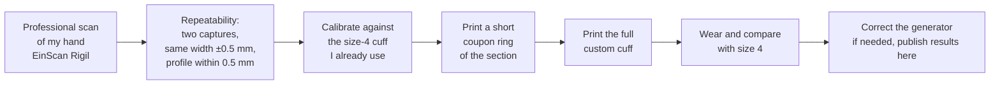

# Validation

> **Status: experimental.** The geometry has been checked in CAD and in software. **No custom cuff from this app has been worn by anyone yet.** This page lists what has been checked, what has not, and how that gap will be closed.

- [What has been verified](#what-has-been-verified)
- [What has not been verified](#what-has-not-been-verified)
- [Validation plan](#validation-plan)
- [How you can help](#how-you-can-help)
- [Change log of validation results](#change-log-of-validation-results)

## What has been verified

### 1. CAD-level checks on the pre-built width variants

All 18 width variants that the web app builds from (W 80.0–84.0 mm in 0.5 mm steps, right and left) were generated by the CAD generator in `cad/src/`. Each was measured with the manufacturing checks described in [METHOD.md § 8](METHOD.md#8-manufacturing-checks). All 18 pass. The values are recorded in `web/grade/indice_grade_web.json`.

| Measurement | Requirement | Range over the 18 variants |
|---|---|---|
| Single watertight body | 1 body | 18/18 |
| Spring leaf thickness (min) | ≥ 0.85 mm | 0.888–0.893 mm |
| Side gap of the spring slot (min) | ≥ 0.6 mm | 0.660–0.663 mm |
| Shoulder wall (min) | ≥ 7.2 mm | 7.614–7.693 mm |
| Spring slot height | 1.95–2.25 mm | 2.101–2.106 mm |
| Fastener region vs size 4 (volume difference) | ≤ 0.1 mm³ | 0.000–0.012 mm³ |
| Largest dimension | ≤ 160 mm | 108.6–112.6 mm |

### 2. The browser gives the same answer as desktop Python

The web app runs the same Python files as the command-line tool. The sample scan (`examples/Artec_Hand.ply`, a left hand, tape 18.2 cm) was run in both. They chose the same width variant and gave the same predicted and verified gaps.

| Sample hand (left, tape 18.2 cm) | Desktop Python 3.13 | Browser runtime (Pyodide 0.27.7) |
|---|---|---|
| Width variant chosen | W 82.0 mm, left | W 82.0 mm, left |
| Gap over the back of the hand, closest section (before → after) | 2.52 → 0.72 mm | 2.52 → 0.72 mm |
| Largest predicted press into the skin under the spring | 0.44 mm | 0.44 mm |
| Generated STL | reference | byte-identical (same SHA-256), run under Node; same numbers in headless Chromium |
| Time for read + fit + build | about 19 s | about 35 s of computing in headless Chromium (2 cores) |

The current pipeline also reproduces the earlier, slower version exactly: the generated STL has the same SHA-256 and every number in the width table agrees within 0.05 mm (most are identical).

### 3. Browser-built solid vs full CAD rebuild

The browser does not run OpenCascade. It deforms a pre-built variant with a 2D displacement field (see [METHOD.md § 7](METHOD.md#7-building-the-solid-in-the-browser)). To check that shortcut, the same custom cuff was also rebuilt from scratch with the full CAD generator, and the two surfaces were compared:

| Case | Surface deviation, browser vs full CAD | Manufacturing checks, browser (full CAD) |
|---|---|---|
| Sample scan, left hand, W 82.5 mm (development version) | 99th percentile **0.019 mm**; 99.9th percentile 0.07 mm; max 0.29 mm (on the decorative logo and engraving edges) | leaf 0.875 (0.872) · slot side gap 0.66 (0.66) · shoulder 7.668 (7.673) · slot 2.104 (2.095) mm |
| Sample scan mirrored as a right hand, W 82.5 mm (development version) | full CAD build also accepted | leaf 0.867 (0.872) · slot side gap 0.663 (0.663) · shoulder 7.666 (7.666) · slot 2.102 (2.094) mm |

The 2D section routine used in the browser was also compared with the CAD generator's routine directly. The three outlines (outer shell, skin opening, spring slot) agree to 0.000 mm, with and without a dorsal profile.

The comparison was repeated for the current release (sample hand, left, W 82.0 mm): full CAD rebuild (`python cad/build.py custom`) vs the browser build of the same parameters gives a mean surface deviation of 0.0015 mm, 99th percentile 0.019 mm and maximum 0.24 mm (on the logo and engraving edges); volume difference 2.8 mm³ out of about 53 000 mm³. The full CAD build passes all manufacturing checks.

The CAD itself is reproducible from the repository: `python cad/build.py size N` rebuilds the published standard sizes byte for byte (checked for sizes 1, 4 and 7), and `python cad/build.py grid` rebuilds all 18 width variants used by the browser with a maximum surface deviation of 0.000002 mm (only the triangulation differs between OpenCascade builds).

### 4. Generated cuff vs scan (sample hand)

Every generated cuff is re-checked against the scan before files are offered ([METHOD.md § 9](METHOD.md#9-checking-the-generated-cuff-against-the-scan)). For the sample hand:

| Sample hand | Standard size 4 | Custom cuff (W 82.0 mm, left) |
|---|---|---|
| Mean gap over the back of the hand, at the section closest to the spring | 2.52 mm | 0.72 mm predicted · 0.72 mm measured on the generated cuff |
| Share of that section within 0.5 mm of the spring face | 0 % | 65 % predicted · 63 % measured |
| Largest press of the hand into the spring (must stay below the 2.1 mm travel) | — | 0.44 mm predicted · 0.36 mm measured |
| Rigid parts pressing into the palm (allowed down to −0.5 mm as skin give) | −0.03 mm | −0.44 mm predicted · −0.45 mm measured |
| Verdict of the re-check | — | accepted (difference 0.005 mm, limit 0.15 mm) |

The cuff only follows the section closest to the spring: averaged over all five sections, the gap goes from 5.3 to 3.5 mm, because the hand tapers along the 26 mm band.

The sample hand belongs to an unknown person and has never worn a cuff. These numbers show that the pipeline does what it is designed to do. They do not show that the cuff is comfortable.

### 5. Regression and robustness tests

The test suite (`tests/`, run on every push by GitHub Actions on Linux, Windows and macOS) covers:

- **Real scans.** The sample scan as a left hand and mirrored as a right hand, with expected variant and results.
- **Synthetic transforms.** The same scan rotated, translated, scaled (mm, cm, m) and mirrored. The result must not change except where it should (left/right).
- **Refusals and questions.** A wrong declared side. Ambiguous orientation, which returns a question with candidate readings instead of a dead end. Holes and open edges near the band. Tape and scan disagreeing. (A scan whose band falls on the thumb base is handled in code but has no test scan yet.)
- **Boundaries and bad numbers.** Inputs at the edges of every range. NaN and infinity injected into the intermediate measurements, which must always lead to a recorded refusal and never to a delivered file.
- **Browser end-to-end test.** A headless Chromium loads the page, runs the sample hand and checks that the files are delivered.

Scans that I am not allowed to redistribute are tested locally and are not in the repository.

Current suite: 45 fast tests and 38 slow tests (including the full sample-hand pipeline, rotations, metres and mirroring, the release gates — tape required before a custom build, no size recommended unless it passed, no manufacturing files after a failed check — and injected NaN/infinity values), all passing (one CAD test is skipped where OpenCascade is not installed), plus four browser end-to-end tests: the sample hand; orientation fixes and knuckle-line click; the tape gate on a scan loaded as a user file (no tape → blocked, wrong tape → refused, right tape → 3MF); and page states with keyboard checks. The browser tests also check that no request leaves the local computer. In CI, the fast tests run on Linux, Windows and macOS; the slow tests, the browser tests and a CAD rebuild run on Linux; the public site is deployed only after CI passes on the same commit.

## What has not been verified

| Not yet verified | Why it matters |
|---|---|
| **A real person wearing a custom cuff** | This is the main open question. Everything above is geometry. |
| Skin tolerance (0.5 mm) and preload (0.2 mm) | Both are assumptions. They may be too tight or too loose for real skin. |
| Spring force and deflection | The 2.1 mm travel is a free gap, not a force model |
| Retention while brushing, wet use | Not modelled at all |
| Phone-scan accuracy for this purpose | Only the sample scan from a professional scanner has been run through the full pipeline |
| Hands outside the custom range (W 80–84 mm) | Deliberately not offered yet |
| Long-term durability of a custom spring | The custom spring is lowered toward the hand, but its thickness is checked (≥ 0.85 mm). Fatigue has not been tested. |

## Validation plan

I will validate on my own hand first, because I already wear a standard size-4 FreshCuff and know how it feels.

1. **Scan.** I paid a professional scanning service to scan my hand with an EinScan Rigil, and **I am waiting for the files**. The planned captures are two scans of the scan pose, one with my standard size-4 cuff worn on the hand, and one of the cuff alone.
2. **Repeatability.** Run the app on both captures. Provisional criterion: the same width (±0.5 mm), and dorsal profiles that differ by no more than 0.5 mm.
3. **Calibration against the cuff I wear.** The scan of the size-4 cuff on my hand shows the real gaps and the real side clearance of a cuff I know is comfortable. Those become the reference for the 0.5 mm side-clearance target and the 0.2 mm preload, which may change.
4. **Coupon first.** Print a short ring with the custom cross-section, only a few millimetres long. It is cheap and fast to check the fit across the back of the hand.
5. **Full cuff.** Print the full custom cuff (PETG, settings from the 3MF) and wear it next to the standard size 4 in the same tasks. I will record the gaps, any pressure points, how easy it is to put on and take off, and comfort.
6. **Scan the printed cuff on the hand**, if the service or a scanner allows it, to compare the real gaps with the predicted ones.
7. **Correct and publish.** If the cuff is too tight, too loose or uncomfortable, I will adjust the generator and record the change and the reason here.

Until step 5 is done and reported here, treat every custom cuff as a **prototype for a supervised dry fit**.

## How you can help

If you have a scan of your hand, or you can make one, **please try the app and tell me what happened**, even if it refused your scan.

1. Run the app (online or offline). Your scan stays on your computer.
2. Open a **[fit feedback report](https://github.com/sensecraft3d-eng/freshcuff-scanmade/issues/new?template=fit-feedback.yml)**. The form asks for:
   - the scanner or app you used, the hand side and your tape measurement;
   - the standard size you wear, if any, and the size the app recommended;
   - whether a custom cuff was built and printed;
   - if you dry-fitted it: gaps, pressure points, how easy it was to take off, and comfort on a 1–5 scale.
3. **Optionally attach the report JSON** produced by the app. It contains measurements of the band (five 2D outlines across the band, gaps, the placement found), your tape value and the scan's file name and hash, but **no 3D surface of your hand**. Please open it and check before attaching. Rename the scan before running the app if its file name contains your name.
4. **Do not attach your scan** unless you really want to share it publicly. GitHub issues are public. If you want to share a scan privately for testing, say so in the issue and we can arrange it. It is entirely optional.

Reports of refusals, wrong landmarks and confusing messages are just as useful as fit reports.

## Change log of validation results

| Date | Version | Result |
|---|---|---|
| Not yet publicly released | release candidate | CAD and software checks above. No wearer yet. |
| | | *(my own hand: pending scan files)* |
